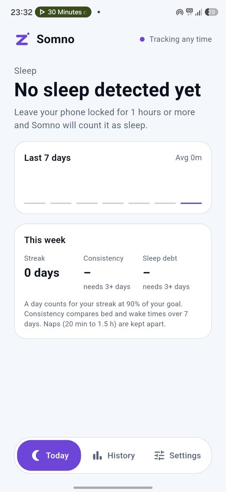
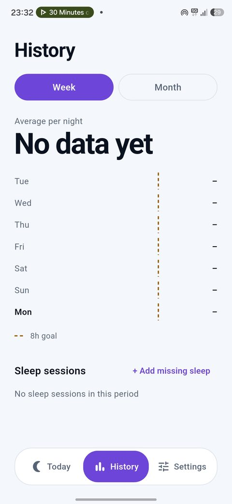
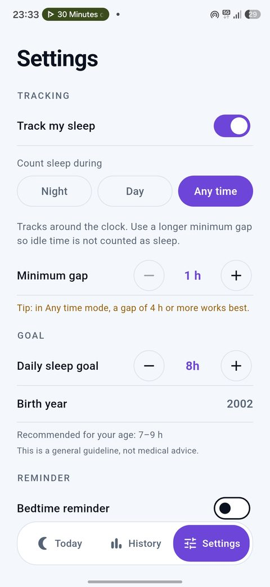
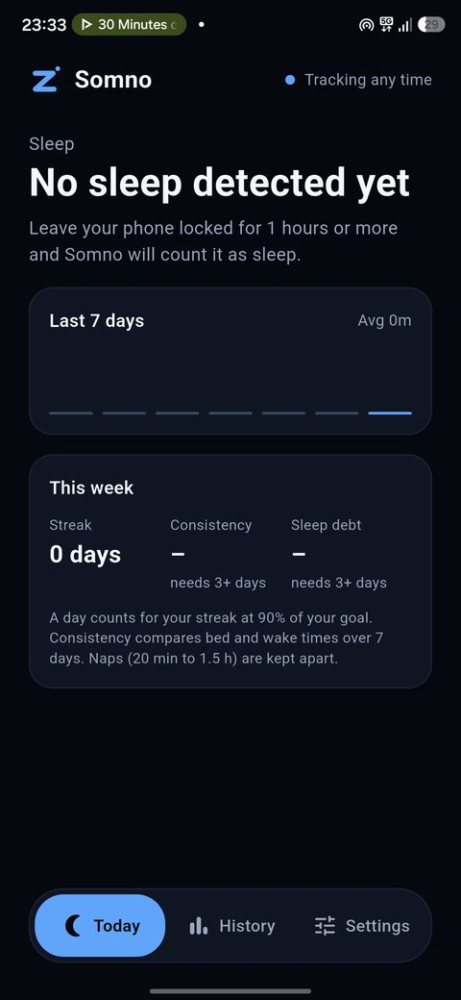
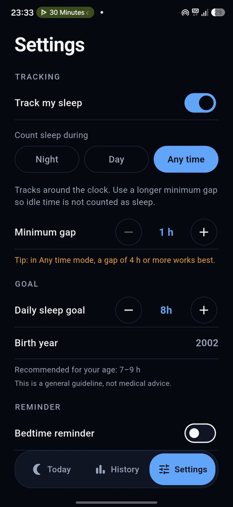
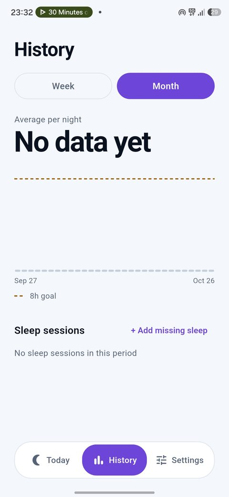
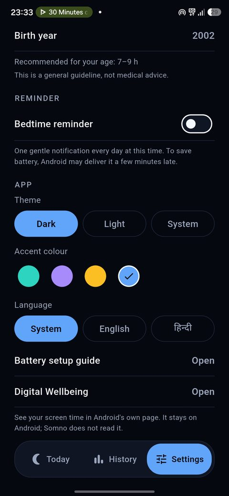
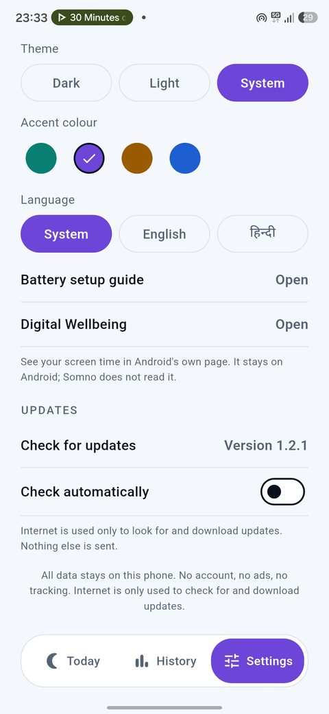

<h1 align="center">Somno</h1>

<p align="center">
  <b>Sleep tracking that never leaves your phone.</b><br>
  Leave your phone locked for a few hours and Somno counts it as sleep.<br>
  No account. No ads. No cloud. No tracking.
</p>

<p align="center">
  <a href="https://github.com/lumio-apps/somno/releases/latest"></a>
  
  
  
</p>

<p align="center">
  
  
  
  
  
</p>

---

## Why Somno

Most sleep trackers want a watch, a microphone, an account or a subscription. Somno uses one
simple idea instead: **when you do not touch your phone for a long stretch, you are most
likely asleep.** That is enough to give you a clear picture of how much you sleep, with
nothing to wear and nothing to upload.

## Features

**Tracking**
- Automatic sleep detection from screen-off and unlock events only
- Three modes: **Night**, **Day** or **Any time**, each with its own start and stop time
- Minimum gap from 1 to 5 hours (3 hours by default)
- Runs quietly in the background and restarts after a reboot or an app update

**Insights**
- Daily sleep goal set from your age (National Sleep Foundation ranges), always shown in the app
- **Streak**: days in a row you reached at least 90% of your goal
- **Consistency**: how steady your bed and wake times were over 7 days
- **Sleep debt**: how far you are above or below your goal over 7 days
- **Naps** (20 minutes to 1.5 hours) are kept apart, so they never change your night averages
- Week and month history, with add, edit and delete for every session

**Phone** (new tab)
- **Battery**: level, charging state and source, temperature, health, voltage, and charge
  cycles on phones that report them
- **This phone**: model, Android version and security patch, processor, free memory and
  storage, screen size and refresh rate, and uptime
- **Screen time** (needs Usage access): today's total, the 5 most used apps with their icons,
  a 7-day chart, and how today compares with yesterday so far
- A shortcut to Android's own battery usage page (Android keeps per-app battery use to itself)
- Read live while the tab is open. Nothing is saved, shared or uploaded

**Comfort**
- Optional **bedtime reminder** at a time you choose
- Dark, light and system themes, plus four accent colours (blue, purple, amber, teal)
- English and Hindi, switchable inside the app
- A battery guide that helps Android keep the tracker alive
- A shortcut to Android's Digital Wellbeing page
- **In-app updates**: check, download and install a new version without leaving the app

## Screenshots

<table>
  <tr>
    <td align="center"><br><sub>Today (light)</sub></td>
    <td align="center"><br><sub>History: week</sub></td>
    <td align="center"><br><sub>History: month</sub></td>
    <td align="center"><br><sub>Settings</sub></td>
  </tr>
  <tr>
    <td align="center"><br><sub>Today (dark, blue accent)</sub></td>
    <td align="center"><br><sub>Settings (dark)</sub></td>
    <td align="center"><br><sub>Reminder, theme, language</sub></td>
    <td align="center"><br><sub>Accent colour, updates</sub></td>
  </tr>
</table>

## Install

1. Open the [latest release](https://github.com/lumio-apps/somno/releases/latest) on your phone.
2. Download `Somno-vX.Y.Z.apk` and open it. Android may ask once to allow installs from your browser.
3. Open Somno, enter your birth year, pick a tracking mode and follow the short battery step.

Android only. Updates after that come from inside the app:
**Settings > Check for updates**.

## How it works

A tiny Android foreground service listens only for two system events: **screen off** and
**user unlock**. It writes their timestamps to the phone. When you open the app, Somno turns
those events into sleep sessions:

- The first screen-off after your last unlock is kept as the possible start of sleep. Short
  glances at the lock screen do not reset it.
- When you unlock, the gap since that screen-off is checked. It becomes a session if it is at
  least your minimum gap and at most 16 hours.
- In **Night** or **Day** mode the sleep must start inside your chosen window (windows may
  cross midnight). **Any time** accepts every start time, so a longer minimum gap is advised.
- A session belongs to the day you woke up. Overlapping sessions are never created.
- You can always fix reality by hand: add, edit or delete any session. Edited and manual
  sessions are marked in the list.

The detection logic is plain Dart with no Flutter dependency, and it is covered by unit tests.

## Privacy

Somno is built to be checkable, not just promised.

- All sleep data stays in a local database on your phone. There is no account and no sync.
- Phone details (battery, device facts) are read live from Android, shown on the Phone tab
  and never saved, shared or uploaded.
- No analytics, no crash reporting, no ads, no third-party SDKs.
- The only network use is **one request to the GitHub Releases API** to look for a newer
  version (at most once a day, and you can turn it off), and the APK download when you choose
  to update. Nothing about you or your sleep is ever sent.
- Android auto-backup is switched off for the app.

| Permission | Why it is needed |
| --- | --- |
| `FOREGROUND_SERVICE`, `FOREGROUND_SERVICE_SPECIAL_USE` | Keep the screen-event listener running |
| `PACKAGE_USAGE_STATS` (optional, you grant it) | Read screen-off and unlock times from Android's own history, so sleep is found even if the phone stops the tracker at night, and read app screen time for the Phone tab. All of it is shown only on the phone and never saved, shared or uploaded |
| `RECEIVE_BOOT_COMPLETED` | Start tracking again after the phone restarts |
| `POST_NOTIFICATIONS` | The tracking notice and the optional bedtime reminder |
| Launcher-app visibility (`<queries>`, no permission) | Show the names and icons of the apps in the screen time list |
| `INTERNET` | Look for and download new versions from GitHub |
| `REQUEST_INSTALL_PACKAGES` | Hand a downloaded update to the Android installer |

## Recommended sleep

Somno suggests a goal from your age, using the National Sleep Foundation ranges. It picks
the middle of the range, rounded to 30 minutes, and you can change it at any time.

| Age | Recommended |
| --- | --- |
| Under 1 year | 12 to 17 h |
| 1 to 2 | 11 to 14 h |
| 3 to 5 | 10 to 13 h |
| 6 to 13 | 9 to 11 h |
| 14 to 17 | 8 to 10 h |
| 18 to 64 | 7 to 9 h |
| 65 and over | 7 to 8 h |

This is a general guideline, not medical advice. Somno estimates sleep from phone use, so it
cannot tell light sleep from deep sleep and it does not diagnose anything.

## Good to know

- With **Usage access** on, Somno runs **no background service at all** and shows no tracking notification: it reads your screen history from Android when you open the app. Open the app every few days, because Android keeps that history only for a short time. Without Usage access, the background tracker runs only inside your sleep window and stops after you wake up.
- On phones that stop background apps at night (Xiaomi, Oppo, Vivo, Huawei, Honor), turn on **Usage access** in **Settings > Tracking status**. Somno then reads your screen history from Android itself instead of relying on the background tracker.
- Android may stop background apps to save battery. Use the in-app **Battery setup guide** and
  set Somno to *Unrestricted* or *Don't optimise*. Some brands (Xiaomi, Oppo, Vivo, Huawei)
  are stricter than others and may need an extra "autostart" switch.
- The bedtime reminder uses Android's normal alarm clock to save battery, so it can arrive a
  few minutes late.
- If you read your phone at night, that time is not counted as sleep, and a long idle
  stretch in the day can be counted when the mode is *Any time*. Edit or delete such sessions
  in **History**.

## Build from source

You need [Flutter](https://docs.flutter.dev/get-started/install) (Dart 3.5 or newer) and the
Android SDK.

```bash
git clone https://github.com/lumio-apps/somno.git
cd somno
flutter pub get
flutter gen-l10n      # generates the translations
flutter analyze
flutter test
flutter run           # on a connected Android phone
```

### Release build

Releases are built by GitHub Actions (`.github/workflows/release.yml`) whenever a version tag
is pushed:

```bash
git tag v1.2.1
git push origin v1.2.1
```

The workflow builds the release APK, signs it with the project keystore and publishes
`Somno-<tag>.apk` on the Releases page. Signing uses these repository secrets:
`KEYSTORE_BASE64`, `KEYSTORE_PASSWORD`, `KEY_ALIAS` and `KEY_PASSWORD`.

The version in `pubspec.yaml` must be raised for every release. Always sign with the same
key, otherwise Android will refuse to update the app and in-app updates will fail.

## Project layout

```
lib/
  core/       pure Dart: sleep detection, stats, versions, phone formatting (unit tested)
  data/       models, settings, SQLite sessions, update service, native bridge
  state/      app state (ChangeNotifier + InheritedNotifier, no extra packages)
  screens/    Today, History, Phone, Settings, Edit, Setup, Battery guide, Update dialog
  ui/         palette, accent colours, shared widgets
  l10n/       English and Hindi texts (ARB)
android/app/src/main/kotlin/online/lumioapps/somno/
  SleepService.kt      screen on/off listener (foreground service)
  EventStore.kt        event queue in SharedPreferences
  Reminder*.kt         bedtime reminder alarm and notification
  PhoneInfo.kt         live battery and device facts for the Phone tab
  AppUsage.kt          app screen time and icons (needs Usage access)
  BootReceiver.kt      restart after boot or update
  MainActivity.kt      bridge between Flutter and Android
test/                  detection, windows, age goals, stats, versions, phone facts
```

**Stack:** Flutter (Material 3), `sqflite`, `shared_preferences`, Kotlin for the Android side.
No state-management or networking packages.

## Roadmap

- Backup and restore, CSV export
- Notes and mood for each sleep
- Weekly and monthly summaries
- Home-screen widget

## Contributing

Bug reports and ideas are welcome in [Issues](https://github.com/lumio-apps/somno/issues).
Before opening a pull request, please run `flutter gen-l10n`, `flutter analyze` and
`flutter test`, and add texts to both `app_en.arb` and `app_hi.arb`.

---

<p align="center">Made by <a href="https://github.com/lumio-apps">Lumio Apps</a>: private by design, open by default.</p>
